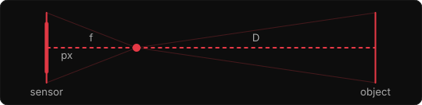
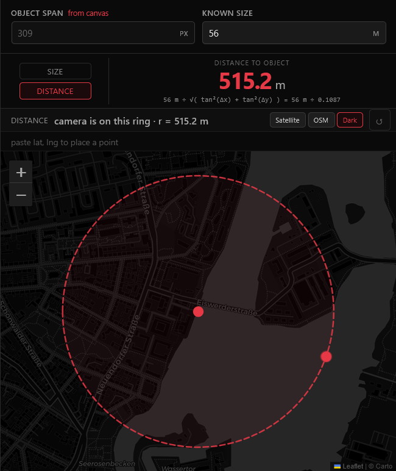

<h1> SiliconAperture</h1>

**Measure the real-world size of an object from a single photograph.**

`SiliconAperture` applies the pinhole camera model to a photograph: mark two points on an object, provide the distance to it and your camera's sensor dimensions, and the tool returns the object's physical size. No uploads. No server. Everything runs locally in your browser.

**[Try it live → kluter.github.io/SiliconAperture](https://kluter.github.io/SiliconAperture/)**


---

## Background

In 2012, on drone campaigns with fixed-wing platforms and a DSLR on a timer, images had to be calibrated the hard way: **Inner orientation** (focal length, principal point, distortion) and **outer orientation** (position and attitude in space). Before you could project any pixel back onto the ground and recover real-world distances. Ground control points laid out by hand, old-school remote sensing.

`SiliconAperture` distills that same principle down to its simplest useful form: one photo, one known distance, one measurement.

---

## How it works

The pinhole camera model relates image pixels to real-world distances through similar triangles:

<table>
<tr>
<td colspan="2">

<p align="center"><code>size = D · √( (Δx · p)² + (Δy · p)² ) / f</code></p>

</td>
</tr>
<tr>
<td valign="middle">

| Symbol | Meaning |
|--------|---------|
| `D` | distance from camera to object, along the camera's axis |
| `Δx, Δy` | pixel span of the object, per axis |
| `p` | size of one pixel on the sensor in mm (sensor size ÷ pixel count) |
| `f` | focal length in mm |

</td>
<td valign="middle">



</td>
</tr>
</table>

By similar triangles, a span `s` on the sensor, `f` behind the pinhole, is a span `D · s / f` at distance `D`. Each axis is converted with the pixel size, then the two components are combined with Pythagoras. This means the line you draw on the photo can be at any angle (horizontal, vertical, or diagonal), and the result is always the true Euclidean length, not its projection onto one axis.

Portrait photos, crops, telephoto and ultrawide shots, and photos from an unknown camera (a 24–35 mm range) are all handled. How, and the limits of the method: **[docs/method.md](docs/method.md)**.

> Accurate results require the object to be **perpendicular to the camera axis**. If the surface is angled toward or away from the lens, the apparent extent seen by the sensor no longer maps linearly to the true physical size, and the measurement will be off.

---

## Solve for distance

<table>
<tr>
<td valign="top">

The same model runs in reverse. 

Toggle **Solve for → Distance**, enter an object's *known* real-world size, and SiliconAperture returns how far the camera was from it:

<p align="center"><code>D = size · f / √( (Δx · p)² + (Δy · p)² )</code></p>

Then click that object on the map to draw a **distance ring**. Every point that far away, i.e. the set of possible camera positions. Cross that ring with any other clue (a known bearing, a road, the skyline) and the camera's location narrows quickly.

</td>
<td valign="top">



</td>
</tr>
</table>

---

## Contributing

The camera database covers 960+ devices across 34 brands. Each entry carries a confidence marker:

| Marker | Dropdown label | Meaning |
|--------|---------------|---------|
| `[✓]` | **confirmed** | Verified from a GSMarena spec page (sensor format + focal length equivalent). `[✓] focal_eq ~` means the sensor was confirmed but the focal equivalent is approximate. |
| `[~]` | **unconfirmed** | Sensor family or optical format is known but not directly verified against a spec page. |
| `[?]` | **missing data** | No source data; values are estimates. |

**How a sensor size is found:** a `[✓]` value is *calculated* from hard data, using either pixel math (`width = pixels across × pixel pitch`) or EXIF (`width = 36 × focal ÷ 35mm-equivalent focal`). A `[?]` value is *estimated* from the marketing format alone (e.g. "1/2.55-inch"), which isn't a true measurement, so it's only a ballpark.

Some entries carry no marker: interchangeable-lens bodies (`focal_length: null`) and high-end fixed-lens cameras and drones (DJI, Sony RX, GoPro…), whose specs are published by the manufacturer.

> If you shoot with a device in the list and can verify or correct its sensor dimensions or focal length against real EXIF data, a PR or issue is very welcome. Same if your camera is missing entirely.

---

## How to use

1. **Drop, paste or browse a photo**, or try the demo. Several photos open in tabs, and a refresh keeps them.
2. **Pick the camera.** EXIF fills it in; otherwise choose a model, a preset (phone main, ultrawide, telephoto, APS-C, full frame) or **Unknown**.
3. **Mark the object** by clicking both ends on the photo. The line can be at any angle.
4. **Enter the distance** in metres, or click the camera's and the object's positions on the map.

The result appears as soon as everything is in; the pinhole diagram above the map shows what is still missing. Every control, key and coordinate format: **[docs/controls.md](docs/controls.md)**.

---

## Run it locally

A static site with no build step. Serve the folder with anything:

```bash
npx serve .
# or
python3 -m http.server
```

---

## Security & Privacy

Your photo never leaves your browser: no upload, no server. Both libraries are bundled, and the only network requests are map tiles. Your work is autosaved in the browser (IndexedDB) so a refresh keeps it. Every request, every stored value and all caveats: **[docs/privacy.md](docs/privacy.md)**.

---

## Related

 **[TracePoint](https://github.com/kluter/TracePoint)** - Geolocate a photo by intersecting lines of sight.

 **[ShadowFinder Web](https://github.com/kluter/ShadowFinder-Web)** - Geolocate a photo by the length of a shadow.
